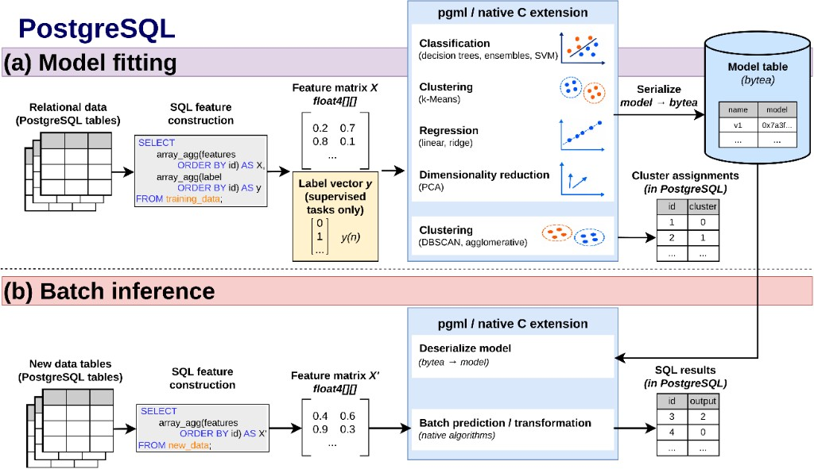
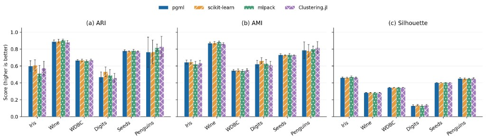
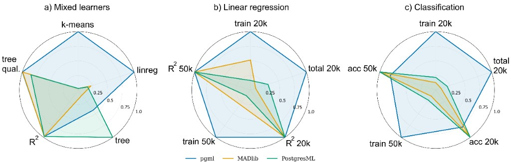
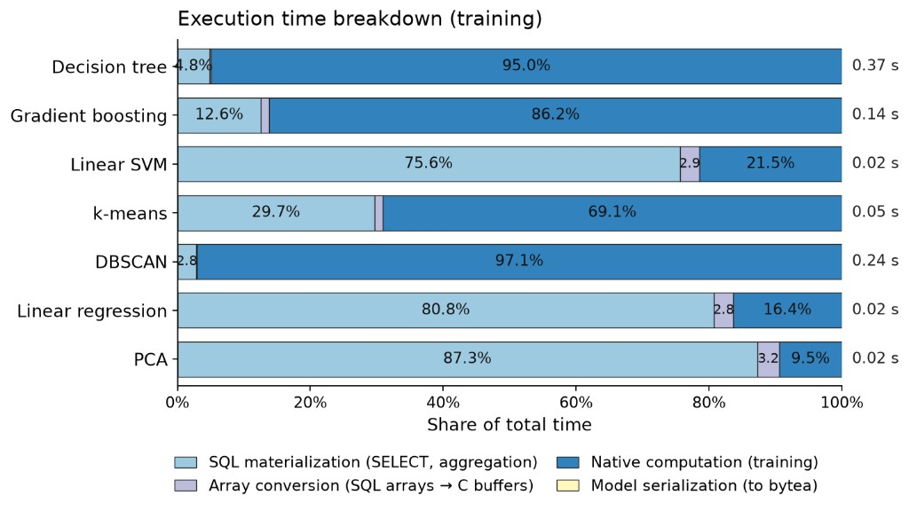

# pgml

PostgreSQL extension for classical machine learning. Classification, clustering, regression, and PCA run inside the database server as C functions. Feature matrices are PostgreSQL arrays. Fitted models are stored as `bytea`. The extension does not link an external numerical library.

## Algorithm families

Training returns a serialized model as `bytea`, except DBSCAN and agglomerative clustering, which return cluster labels as `int[]`.


| Family                   | Methods                                                         | Output  |
| ------------------------ | --------------------------------------------------------------- | ------- |
| Classification           | Decision tree, bagging, gradient boosting, AdaBoost, linear SVM | `bytea` |
| Clustering               | k-means                                                         | `bytea` |
| Clustering               | DBSCAN, agglomerative                                           | `int[]` |
| Regression               | Linear, ridge, regression tree, gradient boosting               | `bytea` |
| Dimensionality reduction | PCA                                                             | `bytea` |


## Learning procedures

Each row is one implemented procedure: the dominant computation and what the fitted result contains.


| Family                   | Method / computation                | Result              |
| ------------------------ | ----------------------------------- | ------------------- |
| Classification           | Decision tree: split search         | Tree nodes          |
|                          | Bagging: repeated tree fitting      | Ensemble            |
|                          | Gradient boosting: residual fitting | Tree sequence       |
|                          | AdaBoost: weighted stumps           | Stump sequence      |
|                          | Linear SVM: O(nd) per pass          | Weights, bias       |
| Clustering               | k-means: O(nKd) per iteration       | Centroids           |
|                          | DBSCAN: neighborhood search         | Cluster labels      |
|                          | Agglomerative: pairwise distances   | Cluster labels      |
| Regression               | Linear / ridge: O(nd² + d³)         | Coefficients        |
|                          | Regression tree: split search       | Tree nodes          |
|                          | Gradient boosting: residual fitting | Base, trees         |
| Dimensionality reduction | PCA: O(nd² + sd³), s sweeps         | Mean, PCs, spectrum |


## Clustering quality

ARI, AMI, and silhouette on standardized real datasets. k-means cells are mean ± standard deviation. Agglomerative rows are the same for pgml, scikit-learn, and mlpack.


| Data / Method      | Impl.     | ARI           | AMI           | Sil.          |
| ------------------ | --------- | ------------- | ------------- | ------------- |
| Iris / k-means     | *pgml*    | 0.599 ± 0.062 | 0.645 ± 0.024 | 0.462 ± 0.007 |
|                    | sklearn   | 0.608 ± 0.065 | 0.647 ± 0.024 | 0.461 ± 0.007 |
|                    | mlpack    | 0.511 ± 0.094 | 0.620 ± 0.035 | 0.472 ± 0.011 |
| Iris / Agglom.     | All three | 0.573         | 0.648         | 0.450         |
| Wine / k-means     | *pgml*    | 0.889 ± 0.019 | 0.869 ± 0.013 | 0.284 ± 0.001 |
|                    | sklearn   | 0.894 ± 0.021 | 0.874 ± 0.016 | 0.285 ± 0.002 |
|                    | mlpack    | 0.908 ± 0.009 | 0.885 ± 0.009 | 0.286 ± 0.001 |
| Wine / Agglom.     | All three | 0.577         | 0.610         | 0.204         |
| WDBC / k-means     | *pgml*    | 0.665 ± 0.010 | 0.546 ± 0.013 | 0.344 ± 0.001 |
|                    | sklearn   | 0.667 ± 0.012 | 0.550 ± 0.015 | 0.344 ± 0.001 |
|                    | mlpack    | 0.662 ± 0.011 | 0.542 ± 0.014 | 0.344 ± 0.001 |
| WDBC / Agglom.     | All three | 0.005         | 0.007         | 0.661         |
| Penguins / k-means | *pgml*    | 0.763 ± 0.179 | 0.787 ± 0.097 | 0.450 ± 0.011 |
|                    | sklearn   | 0.766 ± 0.141 | 0.779 ± 0.073 | 0.448 ± 0.009 |
|                    | mlpack    | 0.815 ± 0.045 | 0.801 ± 0.034 | 0.450 ± 0.005 |
| Penguins / Agglom. | All three | 0.895         | 0.882         | 0.452         |


## DBSCAN quality

ARI, AMI, silhouette, and the number of clusters found on 2D datasets. Cells are mean ± standard deviation.


| Dataset            | ARI         | AMI         | Silhouette  | K           |
| ------------------ | ----------- | ----------- | ----------- | ----------- |
| Iris-2D            | 0.56 ± 0.00 | 0.71 ± 0.00 | 0.75 ± 0.00 | 2.00 ± 0.00 |
| Gaussian blobs     | 1.00 ± 0.00 | 1.00 ± 0.00 | 0.83 ± 0.00 | 3.00 ± 0.00 |
| Anisotropic blobs  | 0.83 ± 0.22 | 0.89 ± 0.14 | 0.71 ± 0.09 | 2.60 ± 0.50 |
| Two moons          | 1.00 ± 0.00 | 1.00 ± 0.00 | 0.39 ± 0.00 | 2.00 ± 0.00 |
| Concentric circles | 0.80 ± 0.42 | 0.80 ± 0.42 | 0.12 ± 0.00 | 1.80 ± 0.40 |


## Layout

```
paper/figures/                         figures included by the manuscript
src/c/                                 pgml.c, pgclust.c, pgreg.c, pgpca.c
src/sql/pgml--1.0.sql                  SQL interface
src/pgml.control
src/build.sh                           build the shared library
experiments/common/                    loader SQL, environment, headline suite
experiments/classification/            UCI suite, categorical features, histogram GBM
experiments/clustering/                clustering quality, k-means acceleration
experiments/regression/                regression multilibrary suite
experiments/pca/                       PCA solver comparison
experiments/systems/                   MADlib, PostgresML, SQL pipelines, stage timing
scripts/                               additional scripts
```


## Manuscript figures


| File                                      | What it shows                                                                                                      |
| ----------------------------------------- | ------------------------------------------------------------------------------------------------------------------ |
| `paper/figures/architecture.png`          | Architecture: SQL feature construction, native training, `bytea` model storage, and batch inference                |
| `paper/figures/kmeans_quality.png`        | k-means ARI, AMI, and silhouette on six datasets                                                                   |
| `paper/figures/indb_peer_comparison.png`  | In-database comparison of pgml, MADlib, and PostgresML                                                             |
| `paper/figures/train_stage_breakdown.png` | Share of training time spent in SQL materialization, array conversion, native computation, and model serialization |




Architecture: SQL feature construction, native training, `bytea` model storage, and batch inference.



k-means ARI, AMI, and silhouette on six datasets.



In-database comparison of pgml, MADlib, and PostgresML.



Share of training time spent in SQL materialization, array conversion, native computation, and model serialization.

## Building the extension

`src/build.sh` compiles the four C files into one `pgml.so`. It uses `pg_config --includedir-server` when `pg_config` is on `PATH`. The link line allows the repeated `PG_MODULE_MAGIC` symbols from the four modules.

```bash
bash src/build.sh
```

Install `src/pgml.control`, `src/sql/pgml--1.0.sql`, and `pgml.so` into the PostgreSQL extension directories, then:

```sql
CREATE EXTENSION pgml;
```

To load a built library by absolute path without `CREATE EXTENSION`:

```bash
psql -h /tmp -p 5433 -d ml_test \
  -v SO=/usr/lib/postgresql/17/lib/pgml.so \
  -f experiments/common/load_abs.sql
```

`src/Makefile` is a PGXS sketch. The sources live in `src/c/`, and `build.sh` is the build used for the measurements.

## Experiments

Run scripts from the repository root. Result paths are relative to that root. Native experiments expect PostgreSQL on `localhost:5433`, database `ml_test`, user `postgres`, password `postgres`, with pgml loaded. MADlib scripts use port `5434`. PostgresML scripts use port `5435`.

`Rscript` and `julia` are taken from `PATH`. Override them with `RSCRIPT` and `JULIA`.


| Script                                                                                    | Writes                                                 |
| ----------------------------------------------------------------------------------------- | ------------------------------------------------------ |
| `experiments/common/rerun.py`                                                             | `results/rerun.json`, `results/extended_features.json` |
| `experiments/common/collect_environment.py`                                               | `results/environment.json`                             |
| `experiments/classification/uci_multilibrary/prepare_splits.py`, `run_experiment.py`      | `results/uci_multilibrary_v2/`                         |
| `experiments/classification/hist_gbm_benchmark.py`, `plot_hist_gbm.py`                    | `results/hist_gbm_comparison.json`                     |
| `experiments/classification/categorical_benchmark.py`, `plot_categorical.py`              | `results/categorical_comparison.json`                  |
| `experiments/clustering/clustering_quality/prepare_data.py`, `run_all.py`, `aggregate.py` | `results/clustering_quality_v1/`                       |
| `experiments/clustering/kmeans_acceleration_benchmark.py`, `plot_kmeans_acceleration.py`  | `results/kmeans_acceleration.json`                     |
| `experiments/regression/regression_multilibrary/prepare_splits.py`, `run_experiment.py`   | `results/regression_multilibrary_v1/`                  |
| `experiments/pca/pca_solvers_benchmark.py`, `plot_pca_solvers.py`                         | `results/pca_solvers.json`                             |
| `experiments/systems/madlib_benchmark.py`                                                 | `results/madlib_comparison.json`                       |
| `experiments/systems/postgresml_benchmark.py`                                             | `results/postgresml_comparison.json`                   |
| `experiments/systems/sql_ml_pipeline_benchmark.py`, `plot_sql_ml_pipeline.py`             | `results/sql_ml_pipeline.json`                         |
| `experiments/systems/regime_map.py`, `plot_regime_map.py`                                 | `results/regime_map.json`                              |
| `experiments/systems/public_benchmarks.py`                                                | `results/public_benchmarks.json`                       |
| `experiments/systems/dbinfer_tpcds_benchmarks.py`                                         | `results/dbinfer_tpcds.json`                           |
| `experiments/systems/train_stage_breakdown.py`                                            | `results/train_stage_breakdown/`                       |
| `experiments/systems/optimizations/run_experiment.py`                                     | `results/pgml_optimizations_v2/`                       |


UCI and regression multilibrary runs also need R packages `caret`, `rpart`, `ipred`, `gbm`, `adabag`, `e1071`, and `kernlab`. Clustering comparisons need Python `mlpack` and Julia `Clustering.jl` (project files are in `experiments/clustering/clustering_quality/`). Python packages used by the drivers include `numpy`, `scikit-learn`, `psycopg2`, and, for the external comparisons, `lightgbm`, `catboost`, and `duckdb`. Versions recorded with the runs are in `results/environment.json`.

PostgreSQL-native measurements were run on PostgreSQL 18.6. The MADlib 2.1.0 and PostgresML 2.10.0 comparisons were run on PostgreSQL 15.